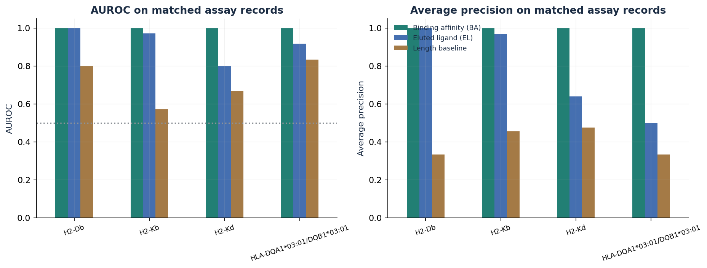

# Ovalbumin MHC benchmark

**How well do pretrained NetMHCpan scores rank recorded binding outcomes for natural peptides of chicken ovalbumin?**

Compare binding-affinity (BA) and eluted-ligand (EL) percentile ranks against published IEDB assays and a simple length baseline. The reference is chicken ovalbumin, UniProt P01012. The repository contains a fixed score snapshot for assayed sequences.

## Results

From 56 IEDB records, **39 peptide–allele pairs** had nonconflicting labels and scores from both models. BA ranked all positives ahead of negatives in the four evaluated strata. Two strata each had only one positive. EL AUROC ranged from **0.80 to 1.00**. See [allele-level metrics](results/metrics.csv), [evaluation coverage](results/evaluation_coverage.csv) and [rank threshold diagnostics](results/rank_threshold_diagnostics.csv).



## Methods

Retain exact, unique peptide matches to P01012 in a single competitive radioactivity binding assay category. Collapse same-label replicates and omit peptide–allele pairs whose labels disagree. Compare model ranks and the baseline on the same available set within each allele. For the baseline, prioritize length closest to 9 residues in class I and 15 in class II. Report AUROC, average precision, observed prevalence and counts at a 2% rank. Class II model inputs shorter than 11 residues were unscored.

## Reproduce

Use Python 3.12 in this repository.

```powershell
python -m venv .venv
.\.venv\Scripts\python -m pip install -r requirements.txt
.\.venv\Scripts\python analysis.py
.\.venv\Scripts\python -m unittest discover -v
```

On macOS and Linux, use `.venv/bin/python` in place of the Windows executable.
The analysis uses the snapshot included in `data/`.

## Interpretation

The benchmark is retrospective. The small, overlapping test peptides and unverified overlap with model training data limit generalization. Recorded binding and prior data curation define the labels. The EL track is evaluated against a binding endpoint, so its scores answer a different biological question from the experimental assay.

## Sources and licenses

[IEDB Query API](https://query-api.iedb.org/docs/swagger/) · [IEDB predictors](https://tools.iedb.org/main/tools-api/) · [NetMHCpan-4.1](https://doi.org/10.1093/nar/gkaa379) · [NetMHCIIpan-4.1](https://doi.org/10.1002/pro.4080) · [UniProt P01012](https://www.uniprot.org/uniprotkb/P01012/entry)

Input URLs and hashes are recorded in [data/sources.json](data/sources.json). The MIT license applies to this repository's code. Original datasets, structures and external scores retain their source terms.
